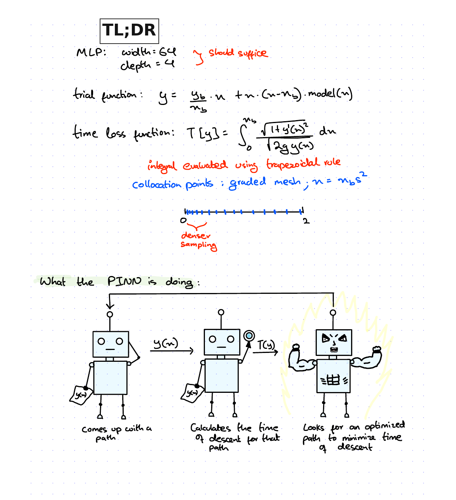
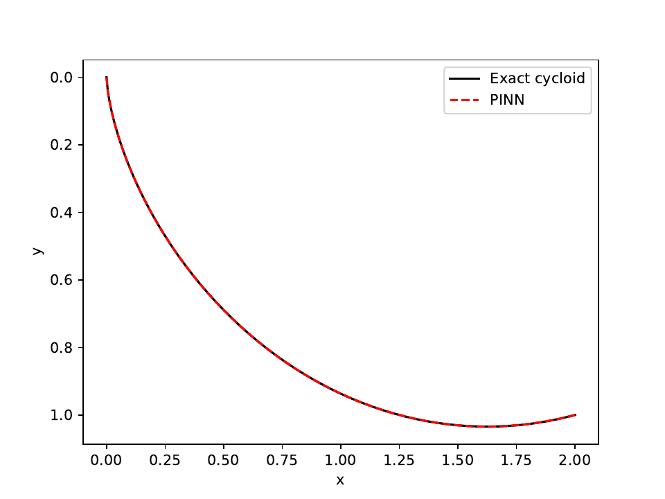

Johann Bernoulli, in 1696, published a challenge to the 'sharpest mathematicians in all the world' in the journal <i>Acta Eruditorum</i>.

> I, [Johann Bernoulli](https://mathshistory.st-andrews.ac.uk/Biographies/Bernoulli_Johann/), address the most brilliant mathematicians in the world. Nothing is more attractive to intelligent people than an honest, challenging problem, whose possible solution will bestow fame and remain as a lasting monument. Following the example set by [Pascal](https://mathshistory.st-andrews.ac.uk/Biographies/Pascal/), [Fermat](https://mathshistory.st-andrews.ac.uk/Biographies/Fermat/), etc., I hope to gain the gratitude of the whole scientific community by placing before the finest mathematicians of our time a problem which will test their methods and the strength of their intellect. If someone communicates to me the solution of the proposed problem, I shall publicly declare him worthy of praise.

The problem posed was the following:

> Given two points A and B in a vertical plane, what is the curve traced out by a point acted on only by gravity, which starts at A and reaches B in the shortest time?

The name <i>brachistochrone</i> comes from Greek: brachistos (shortest) and chronos (time); the curve of shortest time. The problem was first taken on by Galileo in his <i>Discourses on Two New Sciences</i>. He posited that the time taken when following a path described by an arc of a circle is less than the time taken along a straight-line path. Galileo then argued that the path of quickest descent would be an arc of a circle. This would later be shown to be an incorrect deduction.

Bernoulli's challenge received five solutions: Newton's, Jakob Bernoulli's, Leibniz's, de L'Hôpital's, and Johann Bernoulli's own. It is reported that Newton stayed up all night and solved it in a single sitting. This raises the question: how well would a basic PINN (Physics-Informed Neural Network) do against Newton?

This is how I formulated the problem to the PINN:

1. A time loss function.
	Using conservation of energy for two points in a vertical plane, with the point starting from rest, we get the velocity as $$v=\sqrt{2gy}$$ Since the problem is to optimize the path such that the time of descent is minimized, we use $dt=\frac{ds}{v}$. Writing the arc length in terms of the curve $y(x)$, we get $ds=\sqrt{1+y'^2}\,dx$. Thus, the time of descent becomes a functional: $$T[y] = \int_{0}^{x_b}{\frac{\sqrt{1+y'^2}}{\sqrt{2gy}}\,dx}$$
2. Boundary condition.
	In order to ensure that the path always hits the two boundary points, $A(0,0)$ and $B(2,1)$, a constrained expression of the form $y(x)=g(x)+\Phi(x)N(x)$ is used. The particular solution ensures $y(x_a)=y_a$ and $y(x_b)=y_b$, while the approximate distance function $\Phi(x)$ disappears at $x=x_a,x_b$. Thus, the constrained expression formulated for the brachistochrone problem is: $$y(x)=\frac{y_b}{x_b}x+x(x-x_b)\cdot N(x;\theta)$$
3. Particulars of the model.
	By having the model optimize for time, rather than having it satisfy the Beltrami identity, the application here is a true optimizer. The loss evaluated by the model is the descent-time functional itself, which contains an integral. To resolve this, the trapezoidal rule is used to approximate the integral. However, at the release point $A(0,0)$, $v=\sqrt{2gy}\to 0$ as $y\to0$. Since the integrand's denominator is $v$, it diverges near the initial point $A(0,0)$. A work-around for this problem lies in the realization that this is an integrable singularity; the spike in the integrand is infinite but the integral itself is finite. To illustrate, consider the integral $$\int_{0}^{1}{\frac{1}{\sqrt{x}}\,dx}=2$$ The integrand's spike is infinite at $x=0$, however, the integral (the area under the function) is finite. Assuming that the time integral is a similar case of integrable singularity (we know that it is, from the closed-form solution), the problem is thus measuring the area under the function numerically such that it is not overwhelmed by the initial spike. The trapezoid rule, under uniformly sampled points, is simply not able to do so. The work-around is to allow for more sampled points near $x=0$. This can be achieved using a graded mesh: $x = x_b s^2$, where $s$ is uniformly sampled on the interval $[0,1]$.

The trained curve is visually indistinguishable from the exact cycloid. The PINN's minimum time of descent matches the exact cycloid's descent time with an absolute error of 0.0001 s, which is a relative error of 0.013%.

On my computer (M4, single core), it took 68.2 seconds for the model to come up with this path, which is impressive considering Newton had to pull an all-nighter for it. However, Newton was not trying to arrive at an engineered solution between two points as the model has done here. Rather, he, along with the other 'brilliant mathematicians' of his time, was trying to determine the form of the path. That is to say, they were concerned with all shortest paths between all possible points. This distinction is useful when thinking about whether what we are doing is real science, or a much more efficient brute-force calculation.
